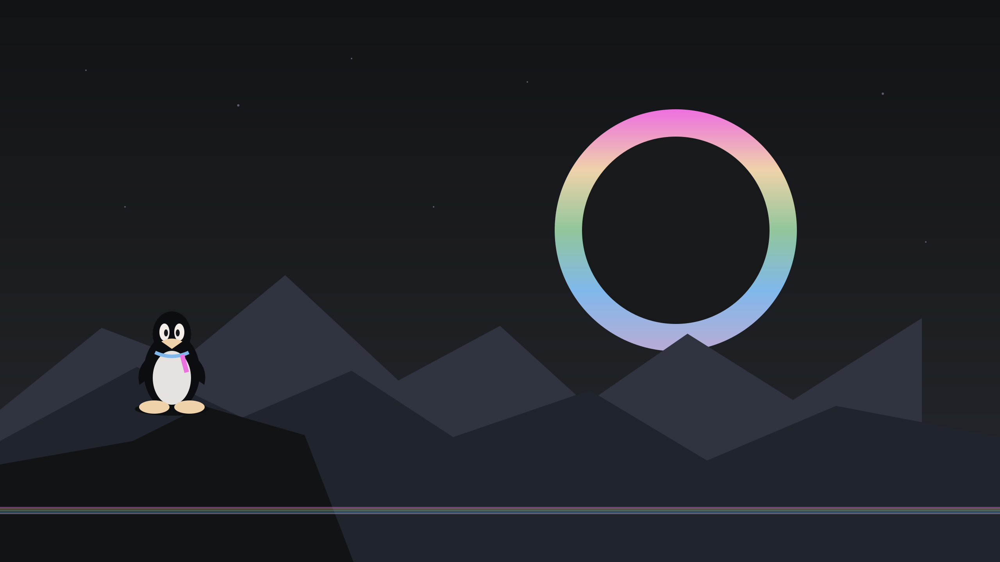

# Pastel Spectrum

A dark Omarchy theme with soft rainbow accents: pink, cream, mint, blue, and
lavender. Includes a Tux eclipse wallpaper, gradient window borders, matching
shell menus and notifications, GTK 3/4 styles, terminal colors, and optional
rainbow Fastfetch and Starship styling.



## Install

Requires a current Omarchy desktop, Git, Bash, and Python 3. The installer writes
only to your home directory and prints a backup path before changing files.

```bash
git clone https://github.com/stspivey76-byte/omarchy-pastel-spectrum.git
cd omarchy-pastel-spectrum
./install.sh
```

Select it later in Omarchy's theme picker or run:

```bash
omarchy theme set pastel-spectrum
```

Your taskbar layout, widgets, keybindings, and shell startup files are preserved.
Omarchy generates supported application and terminal palettes from `colors.toml`.
Personal color overrides in emulator configs can take precedence. Restart GTK
applications to see their new colors; sandboxed apps may need separate styling.

## Terminal setup

Install the optional Fastfetch panel and Starship prompt:

```bash
./install.sh --terminal
```

Requires Fastfetch, Starship, Python 3, and a Nerd Font. This replaces the user's
Fastfetch and Starship configs with backups. It does not change the login shell
or add startup commands. If these are not already configured, add `fastfetch`
to your interactive shell startup and initialize Starship for that shell. Run
`fastfetch` manually to preview the panel. System information is detected live.
The prompt and panel remain installed when switching themes.

## Rainbow taskbar icons

Steven's compatible custom Omarchy bar can tint each widget in alternating
pastel colors:

```bash
./install.sh --rainbow-icons
# Or install both extras:
./install.sh --terminal --rainbow-icons
```

This optional patch requires an existing replacement bar with the compatible
`Bar.qml` loader structure (including Steven's bar). It checks compatibility
before writing any files and backs up the bar. It does not install Steven's
widgets or taskbar layout. Stock and other bars still receive the standard theme
palette, but are not supported by this optional icon patch. System-tray artwork
is tinted as part of its widget. The patch persists when switching themes; use
the printed backup to restore the original bar. Already multicolored spectrum,
workspace, and resource widgets retain their individual colors.

## Restore

Use the exact backup path printed by the installer:

```bash
./install.sh --restore "$HOME/.local/state/pastel-spectrum-installer/BACKUP_NUMBER"
```

Restore reinstates files that were replaced and removes files newly installed
by that run. It overwrites subsequent edits to those same files. Then select your
previous theme and run `omarchy restart shell` if you installed rainbow icons.
Backups are under `~/.local/state/pastel-spectrum-installer/`.

## Development

```bash
python3 -m unittest discover -s tests -v
./install.sh --no-apply  # stage files without changing the running desktop
```

The editable wallpaper is `theme/wallpaper.svg`; its PNG is included for Omarchy.
The palette is `theme/colors.toml`. Optional terminal configs are in `terminal/`.
This project targets Omarchy; it is not a universal desktop installer.

MIT licensed. Created by Steven Spivey.
